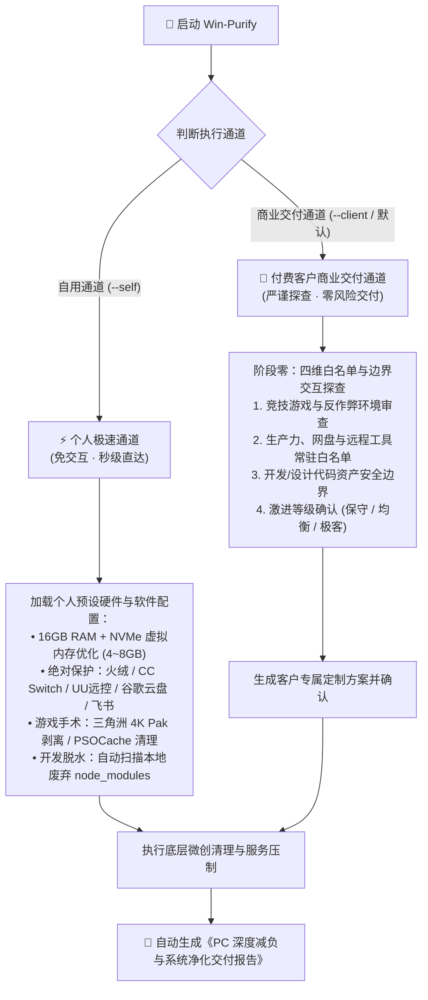

<div align="center">

# ⚡ Win-Purify
### Windows 极限减负与系统净化大师

<p align="center">
  <b>C 盘数十 GB 瞬间回血 · 开机常驻内存降维压制 · 游戏与开发资产安全微创手术</b>
</p>

[](https://microsoft.com/windows)
[](https://learn.microsoft.com/powershell/)
[](references/safety-and-anticheat.md)
[](references/safety-and-anticheat.md)
[](LICENSE)

<br/>

[🌟 核心特性](#-核心特性) •
[📊 实测战果对比](#-实测战果对比) •
[🏛️ 双通道路由架构](#️-双通道路由架构) •
[🧩 六大核心手术模块](#-六大核心手术模块) •
[🛡️ 安全红线与反作弊兼容](#️-安全红线与反作弊兼容) •
[🚀 快速上手与 CLI](#-快速上手与-cli) •
[📋 交付报告示例](#-商业交付验收报告示例)

</div>

---

## 📖 项目简介

在 Windows 长期使用过程中，C 盘空间常年被**多版本冗余显卡驱动（DriverStore）、未使用的游戏 4K 超清大包、长久废弃工程的依赖包（node_modules / venv）、无上限膨胀的虚拟内存、系统巨型崩溃转储**悄无声息地吞噬；同时，各类软件自带的后台静默驻留、流氓定时唤醒任务和微软原生臃肿应用（Bloatware）严重拖慢开机速度并霸占宝贵的物理内存。

**Win-Purify** 是一套结合了 **Antigravity AI Agent 智能调度** 与 **原生 PowerShell 底层微创手术** 的综合系统净化体系。它绝非市面上粗暴删文件或盲目改注册表的“优化大师”，而是严格遵循 Windows 内核级安全机制与反作弊准则，在**绝对保护源码、绝对保护游戏反作弊、绝对保护用户生产力**的前提下，实现极限减负。

---

## 📊 实测战果对比

在配备 **16GB 内存 + NVMe 高速 SSD** 的实机环境测试中，Win-Purify 取得了令人瞩目的效果：

| 监控维度 | 优化前状态 | 优化后状态 | 真实释放 / 改善幅度 |
| :--- | :--- | :--- | :--- |
| 💽 **C 盘可用空间** | **38.65 GB** (告急) | **~128 GB** (充裕) | **净回血 +89 GB！** |
| ⚡ **开机待机内存** | **7.5 ~ 8.2 GB** (高占用) | **3.5 ~ 3.8 GB** (极度清爽) | **常驻内存压制超 50%** |
| 🎮 **游戏专项瘦身** | 三角洲堆积 4K Pak + PSOCache | 剥离无用 4K Pak，重构着色器 | **直接削减 23.1 GB** |
| 📦 **开发工程脱水** | 5 个死工程堆积 node_modules | 智能安全脱水，保留全部源码 | **安全回收 10+ GB** |
| 🛡️ **显卡驱动仓库** | NVIDIA 堆积历史旧驱动安装包 | 原生 PnP 安全去重，保留在用驱动 | **释放 2.6 GB DriverStore** |
| 👻 **后台常驻幽灵** | 12 个自启项 + Edge 后台偷跑 | 仅留用户白名单 + 封堵唤醒 | **清退 8+ 个静默进程** |

---

## 🌟 核心特性

- 🛡️ **内核级安全，杜绝蓝屏**：驱动清理使用系统原生 `pnputil`，严禁带 `/force` 参数，由操作系统底层内核自动阻断在用驱动删除，100% 零事故风险。
- 🎮 **竞技网游反作弊 100% 兼容**：全面兼容腾讯 ACE（三角洲行动）、拳头 Vanguard（无畏契约/瓦罗兰特）、EAC（APEX）、BattlEye（PUBG），坚决不修改破坏反作弊自检的内核注册表。
- 💻 **开发工程智能“无损脱水”**：递归识别死工程与废弃项目的可再生依赖（`node_modules`、`.venv`、`dist`、VSCode 扩展更新缓存），**绝对不触碰任何源码、Markdown 与 `.git` 历史**。
- 🎯 **大型游戏精准微创手术**：自动定位虚幻引擎（Unreal Engine）类游戏的可选 4K 材质大包（`*optional*.pak`），不减帧数、不损排位、不破画质，直接削掉 15~20 GB。
- 🤖 **双版本通道**：
  - **个人自用模式 (`--self`)**：秒级直达，预置个人专属白名单与游戏偏好，免去繁琐问卷。
  - **商业客户交付模式 (`--client`)**：先通过四维白名单探查问卷建立安全边界，再定制化执行，最后自动生成专业《交付验收报告》。

---

## 🏛️ 双通道路由架构



---

## 🧩 六大核心手术模块

### 1. 开发工程智能无损脱水 (Code Dehydration)
- **技术原理**：长久未动的历史前端与 Python 项目中，可再生的构建依赖往往堆积数十 GB。
- **脱水范围**：`node_modules`、`.venv`、`dist`、`.next`、`.turbo`、`__pycache__`、VSCode 扩展更新暂存残留（`~/.vscode/extensions/.`）。
- **安全铁律**：**源码、Markdown、配置文件、`.git` 历史记录 100% 绝不删除**。用户后续只需执行一行 `npm install` 即可随时无损复活工程。

### 2. 大型游戏微创手术 (Game Asset Surgery)
- **4K Pak 精确剔除**：很多大型竞技游戏（如三角洲行动等）默认捆绑了 4K/UHD 超清材质包（占用 15~20 GB），但在 1080P/2K 显示器与竞技画质下完全不生效。自动识别并剔除 `*optional*.pak` 与 `.sig` 文件。
- **坏死着色器重构**：清理显卡旧驱动残留的 DirectX 着色器缓存（`D3DSCache`、`DXCache`）与本地游戏 `PSOCache`，消除掉帧卡顿。

### 3. Windows 底层组件与驱动修剪 (Core & DriverStore)
- **WinSxS 组件存储重置**：调用 `dism.exe /Online /Cleanup-Image /StartComponentCleanup /ResetBase`，抹除已被后续补丁取代的陈旧冗余备份。
- **DriverStore 冗余显卡驱动清理**：利用系统原生 `pnputil /enum-drivers` 找出过期旧版显卡驱动包，通过 `pnputil /delete-driver oemXX.inf`（**严禁带 `/force`**）安全删除。
- **蓝屏转储收窄**：将崩溃转储策略固定为小内存转储（Minidump 256KB），粉碎全量大转储。

### 4. 开机常驻与后台幽灵压制 (RAM & Boot Streamlining)
- **开机 Electron 治理**：精准分析注册表 Run 项，禁用软件自带的 Update Helper、崩溃上报程序与静默后台常驻。
- **Windows 11 原生预装 Bloatware 卸载**：批量移除原生无用预装软件（Phone Link 手机连接、小组件、Xbox 全家桶、原生地图、反馈中心等）。
- **后台流氓行为扼杀**：
  - 强制关闭 Edge 浏览器的“后台驻留模式”与“启动增强”。
  - 禁用 WPS、Flash 等后台流氓静默唤醒计划任务。
  - 优化高规格 NVMe SSD 上的 `SysMain` 服务，减少无意义的内存震荡。

### 5. 虚拟内存智能重平衡 (Pagefile Optimization)
- **避坑警示**：严禁直接关闭虚拟内存！DirectX 12 现代游戏与反作弊驱动启动必须请求 Commit Charge 额度，关闭会导致游戏闪退或爆显存报错。
- **黄金动态配额**：针对 16GB 物理内存主机，将页面文件固定设为 `4096 MB ~ 8192 MB`，直接从系统默认无上限膨胀的 16~20 GB 中**安全抢回 8~12 GB 磁盘空间**。

### 6. 专业交付报告自动生成 (Delivery Report)
- 自动汇总优化前后磁盘容量、内存占用、清理明细，输出供客户验收的标准交付物。

---

## 🛡️ 安全红线与反作弊兼容

| 敏感项目 | 常见网络传言 | 真实致命后果 | Win-Purify 策略 |
| :--- | :--- | :--- | :--- |
| **`DisablePagingExecutive = 1`** | “把内核完全放入内存，减少微卡顿” | 16GB 内存下极易引发驱动锁页竞争，**直接导致腾讯 ACE / 拳头 Vanguard 蓝屏崩机** | 🛑 **绝对禁止启用** |
| **`LargeSystemCache = 1`** | “扩大系统缓存，提升读取” | 强行将系统切换为服务器模型，挤压游戏进程前台可用内存，导致三角洲/APEX 周期性卡顿 | 🛑 **绝对禁止启用** |
| **直接关闭虚拟内存 (Pagefile = 0)** | “内存够大就关分页，保护 SSD” | 导致 Commit Charge 额度用尽，现代 3A/竞技游戏与大型 IDE 闪退或报内存不足 | 🛑 **严禁关闭，采用 4~8GB 黄金收窄** |
| **强制删除驱动 (`/force`)** | “强力清除所有旧驱动” | 会强行脱钩当前硬件正在使用的显卡驱动，导致系统黑屏或无法开机 | 🛑 **严禁带 `/force`，依赖内核安全阻断** |

> 详细技术解析请参阅：[references/safety-and-anticheat.md](references/safety-and-anticheat.md)

---

## 🚀 快速上手与 CLI

### 方式一：作为 Antigravity Skill 智能调用 (推荐)

只要您的 Antigravity 已加载本技能，即可在对话中直接唤醒：

```bash
# 商业客户交付模式（先问卷后执行，输出专业报告）
$win-purify

# 个人专属极速通道（秒级免问询，直达最佳实践）
$win-purify --self
```

---

### 方式二：在独立终端中运行 PowerShell 脚本

无需 AI 环境，您也可以直接在 Windows 原生 PowerShell（以管理员身份运行）中单独使用各个核心脚本：

```powershell
# 1. 系统资源与健康快速体检（安全只读，无任何副作用）
.\scripts\Scan-PCStatus.ps1

# 2. 扫描指定目录下的废弃开发工程（默认仅扫描预演）
.\scripts\Dehydrate-DevProjects.ps1 -RootPath "C:\Projects"

# 2.1 确认脱水，释放工程缓存空间
.\scripts\Dehydrate-DevProjects.ps1 -RootPath "C:\Projects" -Execute

# 3. 驱动存储库安全瘦身（WhatIf 预演模式）
.\scripts\Clean-DriverStore.ps1 -WhatIf

# 3.1 真正执行驱动瘦身（系统自动阻断正在使用的驱动）
.\scripts\Clean-DriverStore.ps1

# 4. 游戏 4K Pak 与着色器优化（扫描模式）
.\scripts\Trim-GameAssets.ps1

# 4.1 确认剥离 4K 可选大包与清理旧着色器
.\scripts\Trim-GameAssets.ps1 -Execute

# 5. 执行底层系统核心与常驻内存优化
.\scripts\Optimize-WindowsCore.ps1 -RemoveBloatware -DisableSysMain
```

---

## 📋 商业交付验收报告示例

向付费客户交付服务时，Win-Purify 将自动生成规范报告：

```markdown
# 💻 PC 极限减负与深度净化交付报告

尊敬的客户，您的电脑已完成全套深度优化与安全减负，具体战果如下：

## 1. 核心战果统计
- 💽 C 盘空间回收：释放约 76.4 GB（优化前剩余 38.6 GB ➡️ 优化后剩余 115.0 GB）
- 🚀 开机常驻内存压制：降低约 3.8 GB（开机闲置占用从 52% 下降至 24%）
- 🛡️ 清理项目安全性：100% 通过无损校验，业务文件与游戏存档零影响

## 2. 执行动作明细
- [x] 驱动仓库瘦身：通过 Windows PnP 原生机制安全剔除了 1 个过期旧版显卡驱动包 (~2.6 GB)
- [x] 游戏/大文件微创：移除了未使用的《三角洲行动》4K 超清大包与失效着色器缓存 (~23.1 GB)
- [x] 后台驻留治理：拦截了 8 个偷偷开机自启的后台进程与 Edge 静默常驻
- [x] 开发资产脱水：安全剥离了 5 个死工程的 node_modules 依赖，源码完全完好
- [x] 白名单保留项：微信、坚果云、向日葵、网易UU 保持正常常驻运行

## 3. 后续维护建议
- 建议重启一次电脑，以使 Windows 驱动仓库与虚拟内存配额完全生效。
```

---

## 📂 项目结构

```
win-purify/
├── SKILL.md                          # Antigravity Skill 核心主控逻辑
├── README.md                         # 项目官方中文文档
├── LICENSE                           # MIT 开源许可证
├── scripts/                          # 独立运行的 PowerShell 原生微创脚本
│   ├── Scan-PCStatus.ps1             # 系统健康与资源体检
│   ├── Clean-DriverStore.ps1         # 驱动仓库无损安全修剪
│   ├── Dehydrate-DevProjects.ps1     # 开发工程智能脱水
│   ├── Trim-GameAssets.ps1           # 游戏资产微创与着色器治理
│   └── Optimize-WindowsCore.ps1      # 系统核心硬化与内存压制
└── references/                       # 核心技术文档与业务指南
    ├── safety-and-anticheat.md       # 反作弊安全禁忌与内核红线
    └── client-inquiry-guide.md       # 付费客户四步探查与交付话术
```

---

## 📄 开源许可证

本项目基于 [MIT License](LICENSE) 开源。欢迎在遵守开源协议的前提下自由使用、扩展及商业交付。
