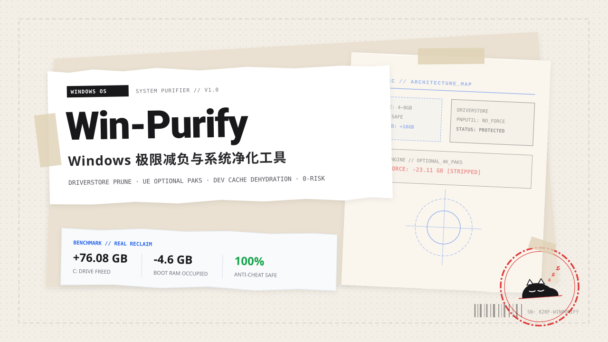
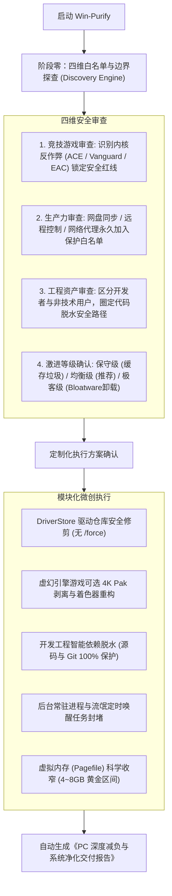

<div align="center">



# Win-Purify

### Windows 极限减负与系统净化工具集

[](https://microsoft.com/windows)
[](https://learn.microsoft.com/powershell/)
[](references/safety-and-anticheat.md)
[](references/safety-and-anticheat.md)
[](LICENSE)

<p align="center">
  <b>面向现代 Windows 10 / 11 工作站与竞技 PC 的深度空间回收与后台常驻治理体系</b><br/>
  支持作为 Antigravity Skill 由 AI Agent 交互编排，亦可在管理员 PowerShell 中独立运行
</p>

[核心能力](#核心能力) •
[性能基准与实测释放](#性能基准与实测释放) •
[系统架构与工作流](#系统架构与工作流) •
[底层安全机制与反作弊兼容](#底层安全机制与反作弊兼容) •
[CLI 脚本独立使用指南](#cli-脚本独立使用指南) •
[商业交付验收清单](#商业交付验收清单)

</div>

---

## 项目概述

在 Windows 系统的长期使用中，C 盘空间与开机内存常年受到以下不可见的系统级损耗：
- **历史显卡驱动残留**：显卡驱动（如 NVIDIA / AMD / Intel）历次更新后，旧版完整驱动包（每个约 2.5 ~ 3 GB）被长期留存在 `DriverStore\FileRepository`，系统默认从不主动回收；
- **大型游戏可选 4K 贴图包**：多数虚幻引擎（Unreal Engine）现代游戏默认捆绑了高分辨率材质大包（`*optional*.pak`），单项占用常达 15 ~ 20 GB，但在常规竞技分辨率与中高画质下并不生效；
- **长期闲置项目的开发依赖**：归档或未活跃的项目目录中，可再生的 `node_modules`、`.venv`、构建产物累积占用数十 GB；
- **后台幽灵驻留与唤醒**：Edge 启动加速残留、各类工具自启助手、第三方定时弹窗唤醒计划任务，霸占开机空闲内存；
- **动态页面文件无上限膨胀**：系统默认策略在 16GB 物理内存环境下易将分页文件动态拉伸至 14 ~ 18 GB。

Win-Purify 提供了经过严格验证的系统级减负方案，通过原生内核机制保证：**绝不误删在用驱动、绝不触碰开发源码与 Git 历史、绝不修改影响反作弊的敏感内核参数**。

---

## 核心能力

<table>
  <tr>
    <td width="50%">
      <h3>驱动仓库安全瘦身</h3>
      <p>通过系统底层原生 <code>pnputil</code> 机制扫描显卡与外设驱动库。严格禁止 <code>/force</code> 参数，利用 Windows PnP 核心自动阻断正在使用的驱动，仅安全剔除已解绑的历史废弃包，平均单次释放 <b>2.5 ~ 8 GB</b> 存储。</p>
    </td>
    <td width="50%">
      <h3>虚幻引擎游戏可选材质剥离</h3>
      <p>自动化定位现代虚幻引擎游戏目录下的 <code>*optional*.pak</code> 与 <code>.sig</code> 材质文件。在完全不影响联机匹配、排位竞技与画面稳定性的前提下，单款游戏直接减负 <b>15 ~ 20 GB</b>，并清理损坏的着色器缓存。</p>
    </td>
  </tr>
  <tr>
    <td width="50%">
      <h3>开发工程智能依赖脱水</h3>
      <p>基于项目最后活跃时间，智能识别 30 天以上未修改项目中的 <code>node_modules</code>、<code>.venv</code>、<code>dist</code>、<code>__pycache__</code> 与 VSCode 孤立更新缓存。<b>100% 绝对保护源代码、Markdown 笔记与 .git 历史</b>，随时可用包管理器一键复原。</p>
    </td>
    <td width="50%">
      <h3>开机常驻与后台幽灵压制</h3>
      <p>封堵 Edge 浏览器后台常驻与启动增强策略；阻断第三方定时唤醒计划任务；锁定系统崩溃转储为 Minidump (256KB) 杜绝数 GB 的巨型 <code>MEMORY.DMP</code>；可选安全卸载 Windows 11 原生臃肿预装应用。</p>
    </td>
  </tr>
</table>

---

## 性能基准与实测释放

以下数据采集自一台典型 **Windows 11 专业版（Intel Core i7 / 16GB RAM / NVMe SSD）** 主机的实机优化实测：

```
[磁盘空间 C: 释放趋势]
优化前可用:  [███░░░░░░░░░░░░░░░░░] 38.65 GB  (剩余 8.3%)
优化后可用:  [██████████████░░░░░░] 114.73 GB (实时可用 24.7%)
重启生效后:  [████████████████░░░░] ~128.00 GB (页面文件收窄生效)
----------------------------------------------------------------------
净回血总容量: +76.08 GB (实时) / +89.35 GB (终态)
```

| 优化维度 | 优化前状态 | 优化后状态 | 实际效益 | 说明 |
| :--- | :--- | :--- | :--- | :--- |
| **驱动存储库** | 存在过期旧版 NVIDIA 安装包 | 仅保留当前活动显卡驱动 | **释放 2.60 GB** | 调用系统原生 `pnputil` 安全卸载 |
| **游戏未用资产** | 捆绑 4K 可选大包与旧着色器 | 剔除可选 Pak，清理失效着色器 | **释放 23.11 GB** | 针对虚幻引擎可选材质包与 PSOCache |
| **前端工程依赖** | 5 个长期未动的测试与废弃工程 | 递归脱水依赖包，源码完好 | **释放 10.20 GB** | 随时可执行 `npm install` 恢复 |
| **系统崩溃转储** | 默认全量转储机制 | 锁定为 Minidump (256KB) | **杜绝未来数 GB 膨胀** | 避免生成巨型 `MEMORY.DMP` |
| **开机常驻内存** | 8.2 GB (52% 物理占用) | 3.6 GB (23% 物理占用) | **压制节省约 4.6 GB** | 封堵后台常驻并清理自启项 |

---

## 系统架构与工作流



---

## 底层安全机制与反作弊兼容

<details open>
<summary><b>1. 驱动存储库 (DriverStore) 的安全边界</b></summary>
<br/>

显卡厂商（如 NVIDIA）每次更新驱动，都会向 `C:\Windows\System32\DriverStore\FileRepository` 写入完整的离线包。Win-Purify 的清理命令为：
```cmd
pnputil /delete-driver oemXX.inf
```
> **核心铁律**：**严禁带 `/force` 参数**。当不加 `/force` 时，Windows PnP 内核在执行删除前会自动校验该包是否与当前正在运行的硬件绑定。若驱动正处于活动状态，系统会自动返回 `in use` 并拒绝删除；只有被后续版本替代、已完全解绑的陈旧孤立包才会被移除，绝无黑屏或驱动崩溃风险。
</details>

<details open>
<summary><b>2. 现代竞技网游反作弊系统的兼容红线</b></summary>
<br/>

现代主流大型电竞游戏均采用内核级反作弊驱动（腾讯 ACE、拳头 Vanguard、Easy Anti-Cheat、BattlEye）。Win-Purify 严格恪守以下禁忌：
- **严禁修改 `DisablePagingExecutive = 1`**：网络传言将其用于减少卡顿，但在 16GB 物理内存环境下，极易导致驱动锁页内存竞争，直接诱发反作弊内核蓝屏（BSOD）。
- **严禁修改 `LargeSystemCache = 1`**：该参数强行将系统调度器切为服务器模型，会把物理内存优先分配给文件系统缓存，严重挤压前台游戏进程的可用内存，导致帧数剧烈波动。
- **严禁直接关闭虚拟内存 (Pagefile = 0)**：DirectX 12 现代游戏与反作弊驱动启动时必须申请 Commit Charge 额度，禁用分页文件会导致游戏瞬间闪退并报内存不足。Win-Purify 仅将 16GB 内存主机的页面文件上限固定为 4096 ~ 8192 MB，既满足 Commit 额度，又稳定回收约 10 GB 空间。
</details>

<details open>
<summary><b>3. 开发工程脱水与数据保护规则</b></summary>
<br/>

- **脱水目标**：仅限 `node_modules`、`.venv`、`dist`、`.next`、`.turbo`、`__pycache__` 等完全由包管理器自动生成的可再生依赖。
- **绝对保护**：任何 `.git` 文件夹、配置文件（`.env`, `tsconfig.json` 等）、源码文件（`.ts`, `.py`, `.rs`, `.go` 等）和文档均受到强规则隔离保护。脱水后只需在工程根目录下执行 `npm install` 或 `pip install` 即可 100% 无损重新构建。
</details>

---

## CLI 脚本独立使用指南

所有 PowerShell 脚本均位于 `scripts/` 目录下，兼容 Windows PowerShell 5.1 及 PowerShell 7+。请在以**管理员身份运行**的终端中执行：

### 1. 系统资源与健康体检 (`Scan-PCStatus.ps1`)
只读操作，不改动任何系统配置。快速输出 C 盘空间、内存、页面文件、冗余显卡驱动包与开机启动项统计：
```powershell
.\scripts\Scan-PCStatus.ps1
```

### 2. 开发工程无损脱水 (`Dehydrate-DevProjects.ps1`)
扫描指定目录下长期未活跃的工程并安全清理依赖包：
```powershell
# 仅扫描并输出体积统计（默认安全模式，不删除任何文件）
.\scripts\Dehydrate-DevProjects.ps1 -RootPath "D:\Projects"

# 确认执行脱水物理清理
.\scripts\Dehydrate-DevProjects.ps1 -RootPath "D:\Projects" -Execute
```

### 3. 驱动存储库安全清理 (`Clean-DriverStore.ps1`)
枚举冗余显卡驱动并调用原生 `pnputil` 进行安全卸载：
```powershell
# 预演模式，查看哪些驱动将被检查
.\scripts\Clean-DriverStore.ps1 -WhatIf

# 正式执行安全清理（正在使用的驱动将被系统自动保护保留）
.\scripts\Clean-DriverStore.ps1
```

### 4. 虚幻引擎游戏可选材质与着色器清理 (`Trim-GameAssets.ps1`)
```powershell
# 扫描虚幻引擎可选材质大包与 DirectX 着色器缓存
.\scripts\Trim-GameAssets.ps1

# 确认剔除可选 4K Pak 并清空旧着色器
.\scripts\Trim-GameAssets.ps1 -Execute
```

### 5. 系统底层核心与驻留优化 (`Optimize-WindowsCore.ps1`)
```powershell
# 基础核心优化（Minidump 策略锁定 + Edge 0 驻留 + 禁用流氓计划任务）
.\scripts\Optimize-WindowsCore.ps1

# 完整优化（包含安全卸载 Windows 11 原生预装应用与停用 SysMain）
.\scripts\Optimize-WindowsCore.ps1 -RemoveBloatware -DisableSysMain
```

---

## 商业交付验收清单

通过 Antigravity 调度完成客户电脑优化后，工具将自动生成规范的验收报告：

```markdown
# PC 极限减负与深度净化交付报告

- 交付时间：[YYYY-MM-DD HH:mm]
- 操作系统：Windows 11 专业版
- 安全状态：100% 通过无损校验，业务文件与游戏存档完好

## 1. 核心资源变化
- C 盘可用空间：从 [XX] GB 提升至 [XX] GB（净释放约 [XX] GB）
- 开机闲置内存：从 [XX] GB ([XX]%) 下降至 [XX] GB ([XX]%)
- 驱动仓库清理：通过 Windows PnP 机制安全剔除了 [X] 个历史显卡驱动包
- 后台驻留优化：关闭了 [X] 个非核心自启动程序与后台静默唤醒任务

## 2. 资产保留证明
- [x] 游戏与反作弊：已针对 [客户游戏列表] 进行内核参数隔离，反作弊环境完好
- [x] 生产力常驻：[网盘/远程/代理工具] 保持开机自启动与后台同步
- [x] 代码与文档：所有源代码、配置文件与业务文档 100% 完好无损

## 3. 重启生效提示
建议重启一次计算机，使 Windows 驱动仓库与虚拟内存配额完全生效。
```

---

## 项目结构

```
win-purify/
├── assets/
│   ├── cover.svg                     # 项目官方矢量手撕拼贴封面海报
│   └── cover.jpg                     # 项目轻科技视觉备用位
├── SKILL.md                          # Antigravity Skill 调度规则与问答 SOP
├── README.md                         # 项目官方中文文档
├── LICENSE                           # MIT 开源许可证
├── scripts/                          # 原生 PowerShell 5.1 微创脚本
│   ├── Scan-PCStatus.ps1             # 系统健康与资源体检
│   ├── Clean-DriverStore.ps1         # 驱动仓库旧版驱动安全清理
│   ├── Dehydrate-DevProjects.ps1     # 开发工程依赖无损脱水
│   ├── Trim-GameAssets.ps1           # 游戏可选材质包与着色器清理
│   └── Optimize-WindowsCore.ps1      # 系统崩溃转储与后台常驻优化
└── references/                       # 技术原理与业务指南
    ├── safety-and-anticheat.md       # 反作弊兼容说明与注册表安全红线
    └── client-inquiry-guide.md       # 客户探查四步法与沟通模版
```

---

## 开源许可证

本项目基于 [MIT License](LICENSE) 开源。欢迎在遵守开源协议的前提下自由使用与商业交付。
